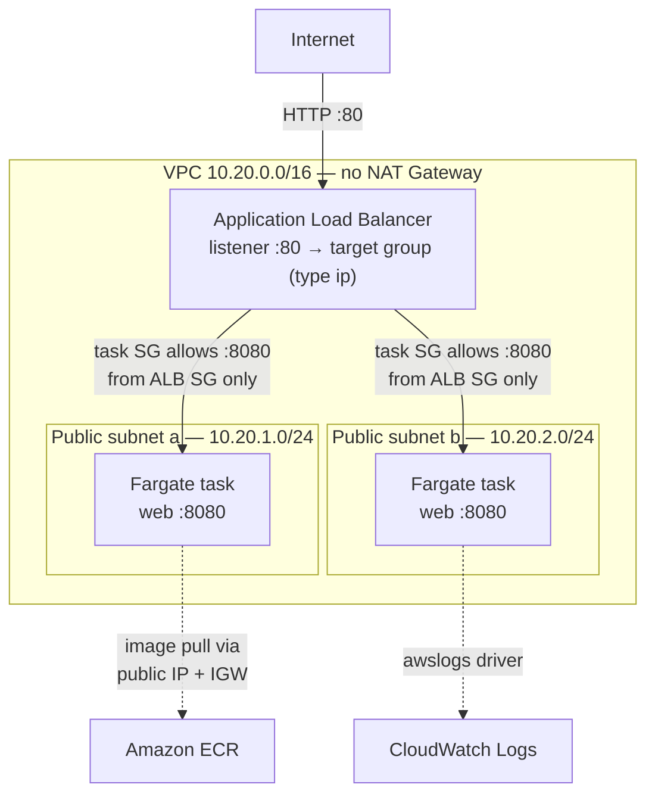

# ECS Fargate lab

A hands-on ECS lab that builds the whole stack from nothing with the AWS CLI —
VPC, ECR, IAM, ALB, Fargate service — then ships a rolling deployment and tears
it all down. Deliberately not Terraform: the point is to create each primitive
by hand once, so that when a module hides it later you know what is underneath.

## Quick reuse

**What this does:** stands up a 2-AZ VPC with public subnets, pushes a small
Flask container to ECR, creates the task execution and task roles, puts an
internet-facing ALB in front of two Fargate tasks, and gives you a one-command
rolling deploy plus a debug script that reads the four places ECS hides its
errors.

**Prerequisites:** AWS CLI v2, Docker running locally, and credentials for a
sandbox or personal account. Check with `aws sts get-caller-identity` before
running anything.

```bash
cd scripts
chmod +x *.sh

./01-network.sh          # VPC, 2 public subnets, IGW, ALB SG + task SG
./02-ecr-build-push.sh v1  # build ../app, create ECR repo, push
./03-iam.sh              # execution role, task role, log group
./04-alb.sh              # ALB, target group (type ip), listener :80
./05-ecs-service.sh      # cluster, task definition, service — prints the URL

curl http://<alb-dns>/   # repeat: served_by flips between tasks
```

Ship a new version with `./06-deploy.sh v2`. When something breaks, run
`./debug.sh`. **Always finish with `./99-teardown.sh`** — see [Cost](#cost).

Each script writes the IDs it created into `scripts/state.env` (gitignored), so
you can stop after any step and resume later.

**Gotchas worth knowing before you start:**
- The target group **must** be `--target-type ip`. Fargate uses `awsvpc`
  networking, so every task gets its own ENI and private IP; the target group
  registers IPs, not instances. Set it to `instance` and you get a target group
  that silently never registers anything and an ALB that 503s forever.
- There is **no NAT Gateway** here. Tasks run in public subnets with
  `assignPublicIp=ENABLED` because that is the only route out to ECR and
  CloudWatch. Flip that to `DISABLED` without adding VPC endpoints and tasks die
  with `CannotPullContainerError` before your code ever runs.
- A container that fails the ALB health check produces **perfectly healthy
  application logs**. The error only exists in the target group's view. This is
  why `debug.sh` reads target health, not just logs.

## Architecture



The two dotted arrows are the reason the tasks need public IPs. ECR and
CloudWatch are public endpoints, and with no NAT Gateway the task's own public
IP through the internet gateway is the only way out. In production you would
replace both with VPC endpoints and move the tasks into private subnets — same
diagram, different plumbing on the right.

## How it works

**Security groups reference each other, not CIDRs.** The task SG allows port
8080 from the ALB's *security group ID*, so nothing on the internet can reach a
task directly even though the tasks sit in public subnets with public IPs.
Public subnet means routable outward, not open inward — those get conflated
constantly.

**Two IAM roles, and they are not interchangeable.** `03-iam.sh` creates both:

| Role | Used by | When | Typical failure |
|---|---|---|---|
| Execution role | the ECS agent | *before* your code runs — image pull, log stream creation, resolving SSM/Secrets values named in the task definition | `CannotPullContainerError`, `ResourceInitializationError`, no logs at all |
| Task role | your application code | at runtime, via the SDK | `AccessDenied` from boto3, app starts fine |

If there are no logs, suspect the execution role. If there are logs and an
AccessDenied inside them, suspect the task role.

**The service, not the task definition, owns placement.** Subnets, security
groups and `assignPublicIp` live in the service's network configuration; CPU,
memory, image and log driver live in the task definition. Changing the image
means a new task definition revision; changing the subnets means updating the
service.

**Deployment circuit breaker is on** (`rollback=true` in `05-ecs-service.sh`).
Push a broken image and ECS rolls back by itself rather than sitting at zero
healthy tasks indefinitely.

## Configuration

Everything is set at the top of `scripts/env.sh`. No account-specific values are
committed — `ACCOUNT_ID` is resolved at runtime from `sts get-caller-identity`
and every ARN is built from it.

| Variable | Default | What it is |
|---|---|---|
| `AWS_REGION` | `ap-south-1` | Region for every resource. Override via env var or edit in place. |
| `PREFIX` | `ecslab` | Name prefix on every resource, so the whole lab is easy to find and delete. |
| `VPC_CIDR` | `10.20.0.0/16` | Lab VPC range; subnets are `/24`s inside it. |
| `APP_PORT` | `8080` | Container port. Must match `containerPort` in the task definition and the target group port. |
| `DESIRED_COUNT` | `2` | Tasks the service runs. Env var, read by `05-ecs-service.sh`. |
| `ACCOUNT_ID` | resolved at runtime | Never hardcoded. |

The task definition is a template, `scripts/task-definition.json.tpl`, with
`__PLACEHOLDER__` tokens substituted by `sed` at register time. Edit the
template, not a rendered copy.

## Cost

Roughly **$0.07/hour while running**, so a 3-hour session is about $0.20. Left
running for a month it is roughly $50.

| Component | Rate | Per hour |
|---|---|---|
| Application Load Balancer | ~$0.0225/hr + LCUs | $0.023 |
| Fargate vCPU (0.5 total) | $0.04048 per vCPU-hour | $0.020 |
| Fargate memory (1 GB total) | $0.004445 per GB-hour | $0.004 |
| Public IPv4 addresses (4) | $0.005/hr each | $0.020 |

Rates are the published `us-east-1` figures; `ap-south-1` runs within a few
percent. ECR storage adds about 2 cents a month for a ~200 MB image, and
CloudWatch Logs ingest is under a cent at lab traffic.

Two line items people do not expect:

- **Public IPv4 addresses have been billed since Feb 2024.** This lab uses four
  — two for the ALB, one per task — which is nearly a third of the hourly cost.
  It is still far cheaper than the ~$35/month a NAT Gateway would add.
- **Container Insights is enabled** in `05-ecs-service.sh`. It publishes custom
  CloudWatch metrics per task and can cost more than the compute does on a small
  cluster. Set it to `disabled` if you are leaving the cluster up.

If your account is under 12 months old, the ELB free tier (750 hours of ALB
per month) covers the load balancer entirely. Fargate has no free tier.

The ALB and the IPv4 addresses bill whether or not anything is using them. To
park the lab overnight without tearing it down:

```bash
aws ecs update-service --cluster ecslab-cluster --service ecslab-svc --desired-count 0
```

That drops you to about $0.03/hour and scales back up in a minute.

## Cleanup

```bash
cd scripts && ./99-teardown.sh
```

It prompts for confirmation, then deletes in dependency order. Two ordering
constraints it handles that a naive teardown gets wrong:

- The **ALB must be fully deleted before its security groups can be**, because
  its ENIs hold a reference. The script waits on `load-balancers-deleted` and
  then retries the SG deletes up to six times.
- The **service must be scaled to 0 and drained** before the cluster will
  delete.

Afterwards, confirm in the console under **EC2 → Load Balancers** and
**VPC → Your VPCs** that nothing is left. The script removes `state.env` on
success, so an empty `state.env` means teardown completed.

## Troubleshooting

`./debug.sh` prints, in order: service events, why recent tasks *stopped*,
target group health, and the latest log stream. Section 2 is almost always where
the real answer is — the console buries it three clicks deep under a stopped
task.

| Symptom | Cause |
|---|---|
| `CannotPullContainerError` | Execution role missing `AmazonECSTaskExecutionRolePolicy`, or no route to ECR (private subnet with no NAT and no VPC endpoints, or `assignPublicIp=DISABLED`) |
| `ResourceInitializationError` | Same family — networking or egress, or an SSM/Secrets value the execution role cannot read |
| "Task failed ELB health checks" | Wrong `containerPort`, app not bound to `0.0.0.0`, `/health` not returning 200, or the task SG does not allow the ALB SG |
| Target state `unused` | Target group is not attached to a listener |
| Service stuck at 0 running | Read the service events in section 1 — they always say why |
| `exitCode 1` with app logs present | Your code. Read section 4. |

The lab is built to make you produce these on purpose rather than read about
them. The exercises in the Quick reuse flow walk through breaking the port
mapping, stripping the execution role policy, and disabling the public IP, then
reading how each one *presents* — which is different each time, and rarely where
you would first look.

## References

- [Amazon ECS task definition parameters](https://docs.aws.amazon.com/AmazonECS/latest/developerguide/task_definition_parameters.html)
- [Task execution IAM role](https://docs.aws.amazon.com/AmazonECS/latest/developerguide/task_execution_IAM_role.html)
- [Fargate task networking (`awsvpc`)](https://docs.aws.amazon.com/AmazonECS/latest/developerguide/fargate-task-networking.html)
- [Target groups for your Application Load Balancer](https://docs.aws.amazon.com/elasticloadbalancing/latest/application/load-balancer-target-groups.html)
- [Deployment circuit breaker](https://docs.aws.amazon.com/AmazonECS/latest/developerguide/deployment-circuit-breaker.html)
- [AWS Fargate pricing](https://aws.amazon.com/fargate/pricing/)
