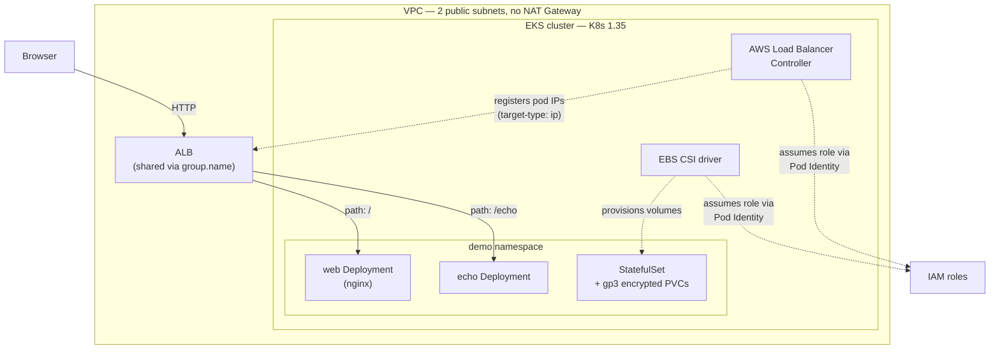

# EKS cost-optimized practice cluster

A throwaway EKS cluster for hands-on practice — Terraform spins it up with Spot nodes,
no NAT Gateway, and a single ALB shared by two apps, then a teardown script removes
everything including the resources the in-cluster controllers create that Terraform
doesn't know about.

## Quick reuse

**What this does:** stands up a minimal-cost EKS cluster (control plane + 2 Spot
worker nodes), installs the AWS Load Balancer Controller and EBS CSI driver via
EKS Pod Identity, deploys two sample apps behind one shared ALB, and a StatefulSet
with encrypted EBS volumes — then tears all of it down cleanly.

**Prerequisites:** Terraform >= 1.10, AWS CLI v2, kubectl, and admin-level AWS
credentials in a sandbox/personal account. Test with `aws sts get-caller-identity`
before running anything.

```bash
cd terraform
terraform init
terraform apply

aws eks update-kubeconfig --region ap-south-1 --name eks-practice
kubectl apply -f ../manifests/

# or just run the wrapper scripts, which do all of the above plus wait for the ALB:
cd .. && ./scripts/up.sh
```

Tear down with `./scripts/down.sh`, **not** `terraform destroy` directly — see
[Cleanup](#cleanup) for why that matters.

**Gotchas (hit these during actual runs, not theoretical):**
- If `kubectl` returns `Unauthorized`, your shell's active AWS identity isn't the
  one that ran `terraform apply` — EKS only grants cluster-admin to whichever
  principal created it (`enable_cluster_creator_admin_permissions = true`). Check
  with `aws sts get-caller-identity` and switch profiles, or add an access entry
  for the identity you actually want to use.
- `terraform destroy` run before deleting the Kubernetes Ingress/PVC objects
  orphans the ALB and EBS volumes, because the AWS Load Balancer Controller and
  EBS CSI driver created them *inside the cluster*, not through Terraform state.
  They keep billing and can block the VPC delete with `DependencyViolation`.

## Architecture



Both Ingresses carry `alb.ingress.kubernetes.io/group.name: practice`, so the
controller creates **one** ALB instead of one per Ingress — each extra ALB is
roughly $18–25/month in LCU + hourly charges, which adds up fast on a practice
cluster that gets rebuilt often.

## How it works

**No NAT Gateway.** Worker nodes sit in public subnets with public IPs
(`map_public_ip_on_launch = true`) instead of private subnets behind a NAT
Gateway. A NAT Gateway alone is ~$33/month plus data processing — not worth it
for a cluster that's up for a few hours at a time. Not a pattern to carry into
production.

**Spot capacity.** The managed node group requests `capacity_type = "SPOT"`
across two similar instance types (`t3.medium`, `t3a.medium`) to improve Spot
availability, at roughly 60–70% off On-Demand pricing.

**Kubernetes version pinned to standard support.** EKS charges $0.10/cluster-hour
on a version still in standard support, and $0.60/hour once it ages into extended
support — a 6x jump. `kubernetes_version` is set explicitly rather than left to
drift.

**EKS Pod Identity, not IRSA.** Both the AWS Load Balancer Controller and the EBS
CSI driver get their AWS permissions through Pod Identity associations
(`aws_eks_pod_identity_association`), which skip the OIDC-provider setup IRSA
needs and use one trust policy (`pods.eks.amazonaws.com`) regardless of cluster.

**`target-type: ip` on both Ingresses.** The ALB routes directly to pod IPs
instead of going through a NodePort and kube-proxy — fewer hops, and health
checks reflect actual pod health rather than node health.

**`preStop` sleep on the nginx pods.** A 15-second sleep before the container
exits gives the ALB time to deregister the pod before it stops, which is what
actually prevents 502s during rolling deployments — the ALB's own deregistration
delay isn't enough on its own if the pod exits immediately.

## Configuration

| Variable | What it is | Default |
|---|---|---|
| `region` | AWS Region | `ap-south-1` |
| `cluster_name` | EKS cluster name, used to tag everything | `eks-practice` |
| `kubernetes_version` | Must stay in EKS standard support | `1.35` |
| `node_instance_types` | Spot instance type pool | `["t3.medium", "t3a.medium"]` |
| `node_count` | Desired/max worker node count | `2` |
| `vpc_cidr` | VPC CIDR block | `10.10.0.0/16` |

No secrets are required anywhere in this stack — only an AWS identity with
sufficient IAM permissions (EKS, EC2, IAM role creation, VPC) to create the
resources.

## Cost

Approximate, `ap-south-1`, while the cluster is running:

| Component | Cost |
|---|---|
| EKS control plane (standard support) | $0.10/hr |
| 2x Spot t3.medium/t3a.medium | ~$0.03–0.05/hr combined |
| 1 shared ALB (LCU usage is near zero for practice traffic) | ~$0.025/hr |
| EBS (20 GB node disks + 2x 1 GiB PVCs, gp3) | a few cents/hr |
| **Total** | **~$0.25–0.35/hr**, roughly $1 for a 3-hour session |

A NAT Gateway, if you add one back for a more production-like setup, adds
~$0.045/hr plus data processing — about $33+/month if left running continuously.

## Cleanup

`./scripts/down.sh` deletes things in this order, which matters:

1. `kubectl delete namespace demo` — this removes the Ingresses and PVCs, which
   triggers the AWS Load Balancer Controller to delete the ALB and the EBS CSI
   driver to delete the volumes, **while those controllers are still running**.
2. Waits (polls `resourcegroupstaggingapi`) until the ALB is actually gone.
3. `terraform destroy` — now safe, because nothing Terraform doesn't know about
   is still attached to the VPC.
4. Lists anything left over: load balancers/target groups still tagged for this
   cluster, unattached EBS volumes, and EKS clusters still present in the Region
   — so a half-finished teardown doesn't quietly keep billing.

Destroying the cluster first and the Kubernetes objects after reverses the
dependency and reliably leaves orphaned ALBs/volumes and a VPC that won't delete.

## Troubleshooting

**`kubectl get pods ... error: You must be logged in to the server (Unauthorized)`**
The identity running `kubectl` isn't recognized by the cluster. EKS only trusts
whichever IAM principal ran `terraform apply` (via
`enable_cluster_creator_admin_permissions`), plus anything explicitly added as
an access entry. Compare `aws sts get-caller-identity` against
`aws eks list-access-entries --cluster-name <name>` — if they don't match,
switch to the right profile/SSO role and re-run `aws eks update-kubeconfig`.
A restrictive SSO permission set (e.g. a Service-Catalog-end-user role) will
also fail on `list-access-entries` itself with `AccessDeniedException` — that's
a separate, narrower identity than the one that built the cluster.

**`VPC` or subnet won't delete during `terraform destroy`, `DependencyViolation`**
Something the AWS Load Balancer Controller or EBS CSI driver created (ALB,
security group, ENI, EBS volume) is still attached. Delete the Kubernetes
objects that own those resources first (see [Cleanup](#cleanup)), or find and
delete the leftover resource manually in the EC2/Load Balancers console, then
re-run destroy.

**Ingress created but no ALB appears**
Check `kubectl logs -n kube-system deploy/aws-load-balancer-controller`. Usual
causes: the Pod Identity association's namespace/service-account don't exactly
match the Helm release's, the public subnets are missing the
`kubernetes.io/role/elb` tag, or the IAM policy attached to the controller's
role is missing a permission.

**PVC stuck `Pending`**
The EBS CSI driver's Pod Identity role needs `AmazonEBSCSIDriverPolicy`, and if
volumes are encrypted with a customer-managed KMS key (not the case by default
here — `aws/ebs` is used), the role also needs `kms:Decrypt`/`kms:GenerateDataKey`
on that key. Also check that `volumeBindingMode: WaitForFirstConsumer` is set
on the StorageClass so the volume is created in the pod's actual AZ.

## References

- [AWS Load Balancer Controller — official IAM policy](https://github.com/kubernetes-sigs/aws-load-balancer-controller) (vendored in `policies/`, pinned to the version used when this was built)
- [terraform-aws-modules/eks](https://github.com/terraform-aws-modules/terraform-aws-eks)
- [terraform-aws-modules/vpc](https://github.com/terraform-aws-modules/terraform-aws-vpc)
- [EKS Pod Identity vs IRSA (AWS docs)](https://docs.aws.amazon.com/eks/latest/userguide/pod-identities.html)
